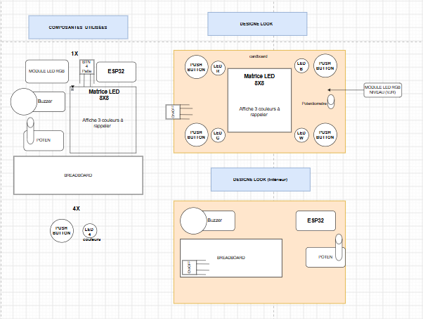

# Projet final : Jeu de mémoire

**Membres de l'équipe :**
- Jose Luis Branco
- Yassine Ani

---

## 1. Objectif du projet

L'objectif de ce projet est de développer un jeu de mémoire interactif à l'aide d'un Arduino Nano ESP32.

Le jeu consiste à mémoriser et à reproduire des séquences de directions affichées sur une matrice LED 8×8. Chaque direction correspond à une couleur et à un bouton physique situé dans l'un des quatre coins du dispositif : rouge, vert, bleu et blanc.

Le joueur doit observer la séquence affichée, la mémoriser, puis appuyer sur les quatre boutons correspondants dans le bon ordre.

Le jeu comprend également trois niveaux de difficulté, des indications lumineuses et des confirmations sonores.

---

## 2. Matériel et composants

| Composant | Quantité | Statut |
|:---|:---:|:---:|
| Arduino Nano ESP32 | 1 | Prêt |
| Breadboard | 1 | Prêt |
| Fils de connexion | Plusieurs | Prêt |
| Boutons-poussoirs (rouge, vert, bleu, blanc) | 4 | À obtenir |
| Bouton ON/OFF (2 broches) | 1 | Prêt |
| LED blanche | 1 | Prêt |
| Module LED RGB | 1 | Prêt |
| Buzzer actif | 1 | Prêt |
| Matrice LED 8×8 | 1 | Prêt |
| Potentiomètre | 1 | Prêt |

---

## 3. Livrables du projet

### Livrable 1 – Configuration initiale

- Créer la structure de base du code.
- Préparer l'environnement de développement Arduino et les instructions d'installation.
- Faire approuver la proposition de projet.

### Livrable 2 – À déterminer

Les objectifs et les tâches de ce livrable seront définis au fur et à mesure de l'avancement du projet.

### Livrable 3 – À déterminer

Les objectifs et les tâches de ce livrable seront définis en fonction de l'évolution du projet et des exigences finales.

---

## Design



---

## 4. Idées et fonctionnalités

### Fonctionnement du jeu

- La matrice LED 8×8 affiche des flèches indiquant les directions à mémoriser.
- Chaque direction correspond à l'un des quatre boutons colorés situés dans les coins du dispositif.
- Les couleurs utilisées sont rouge, vert, bleu et blanc.
- Le joueur doit mémoriser la séquence affichée et reproduire celle-ci en appuyant sur les boutons dans le bon ordre.
- Une erreur entraîne un signal sonore indiquant que la séquence est incorrecte.

### Système de difficulté

Le jeu proposera trois niveaux de difficulté sélectionnables à l'aide d'un potentiomètre.

| Niveau | Couleur de la LED RGB |
|:---|:---:|
| Facile | Vert |
| Moyen | Jaune |
| Difficile | Rouge |

La difficulté pourra varier selon deux paramètres :

#### Mode vitesse
- Réduire le temps d'affichage entre chaque direction.
- Donner moins de temps au joueur pour mémoriser la séquence.

#### Mode séquence
- Augmenter progressivement le nombre de directions à mémoriser.
- Rendre les séquences de plus en plus longues selon le niveau choisi.

### Indications lumineuses et sonores

**LED RGB :**
- Vert : niveau facile sélectionné.
- Jaune : niveau moyen sélectionné.
- Rouge : niveau difficile sélectionné.

**Buzzer actif :**
- Confirmer la sélection du niveau de difficulté.
- Confirmer une séquence correctement reproduite.
- Signaler une erreur lorsque le joueur appuie sur le mauvais bouton.

### Bouton ON/OFF

Un petit bouton à deux broches sera installé sur le côté du dispositif.

Il permettra d'allumer et d'éteindre le système.


## 5. Configuration électronique

### Attribution préliminaire des broches

Le tableau suivant présente les connexions prévues entre les différents composants et l'Arduino Nano ESP32.

| Composant | Broches Arduino Nano ESP32 |
|:---|:---|
| Matrice LED 8×8 | A4 (SDA), A5 (SCL), VBUS (5V), GND |
| Bouton-poussoir rouge | D2, 3V3, GND |
| Bouton-poussoir vert | D3, 3V3, GND |
| Bouton-poussoir bleu | D4, 3V3, GND |
| Bouton-poussoir blanc | D5, 3V3, GND |
| Module LED RGB | D6, D7, D8, alimentation, GND |
| Buzzer actif | D9, alimentation compatible, GND |
| Potentiomètre | A0, 3V3, GND |
| LED blanche | A1, GND (avec résistance) |
| Bouton ON/OFF | En série avec l'alimentation générale |
| Breadboard | 3V3, VBUS (5V selon les modules), GND |
| Fils de connexion | Selon les connexions de chaque composant |

**Remarques :**
- Toutes les masses (GND) doivent être reliées ensemble.
- La breadboard servira à distribuer l'alimentation et à faciliter les connexions.
- Les broches proposées sont préliminaires et pourront être modifiées pendant le développement.
- La compatibilité électrique des composants devra être vérifiée avant le branchement.

---

## 6. Idées et fonctionnalités

Créer un jeu de mémoire physique, amusant et interactif qui combine programmation, électronique et design.

Le joueur devra observer, mémoriser et reproduire des séquences de directions et de couleurs tout en progressant à travers trois niveaux de difficulté.

---

## 7. Développement

Cette section sera utilisée pour documenter le code, les modifications et les différentes étapes du développement du projet.

### Structure du projet

```text
On n'a pas encore décidé
```

---

## 8. Répartition des tâches du projet

**Remarque :** La répartition des tâches présentée ci-dessous est provisoire. Elle représente l'organisation prévue pour le moment et pourra être modifiée selon l'avancement du projet, les besoins et les difficultés rencontrées.

### 8.1 Yassine Ani – Affichage et programmation principale

**Responsable de la logique du jeu et de l'affichage sur la matrice LED 8×8.**

#### Matrice LED 8×8

- Connecter la matrice LED à l'Arduino Nano ESP32.
- Programmer l'affichage des flèches directionnelles.
- Créer les animations et les différents affichages.
- Gérer le temps d'affichage des directions.
- Programmer l'affichage des séquences.

#### Logique du jeu

- Générer des séquences aléatoires.
- Enregistrer les séquences à mémoriser.
- Vérifier les réponses du joueur.
- Gérer les erreurs et les bonnes réponses.
- Programmer la progression du jeu.
- Gérer les conditions de victoire et de défaite.

### 8.2 Jose Luis Branco – Contrôles et composants électroniques

**Responsable des composants électroniques, des contrôles et de la sélection de la difficulté.**

#### Boutons-poussoirs

- Connecter les quatre boutons rouge, vert, bleu et blanc.
- Programmer la détection des pressions.
- Associer chaque bouton à une direction.
- Transmettre les réponses au programme principal.

#### Potentiomètre et difficulté

- Connecter le potentiomètre.
- Lire sa valeur avec l'Arduino.
- Programmer la sélection des trois niveaux de difficulté.
- Définir les paramètres de chaque niveau.

#### LED RGB

- Connecter et programmer la LED RGB.
- Vert : niveau facile.
- Jaune : niveau moyen.
- Rouge : niveau difficile.

#### Buzzer

- Connecter le buzzer.
- Programmer le son de confirmation.
- Programmer le son d'erreur.

#### Autres composants

- Connecter et programmer la LED blanche.
- Installer le bouton ON/OFF.
- Vérifier le fonctionnement de ces composants.

### 8.3 Travail à effectuer ensemble

Les deux membres de l'équipe seront responsables des tâches suivantes :

- L'intégration de toutes les fonctionnalités.
- La connexion finale des différents composants.
- Les tests du jeu complet.
- La correction des erreurs électroniques et logicielles.
- L'amélioration du design physique.
- La préparation de la présentation finale.

*** Note: Les responsabilités ne sont pas définitives et pourront être ajustées ou redistribuées entre les deux membres au cours du développement.
